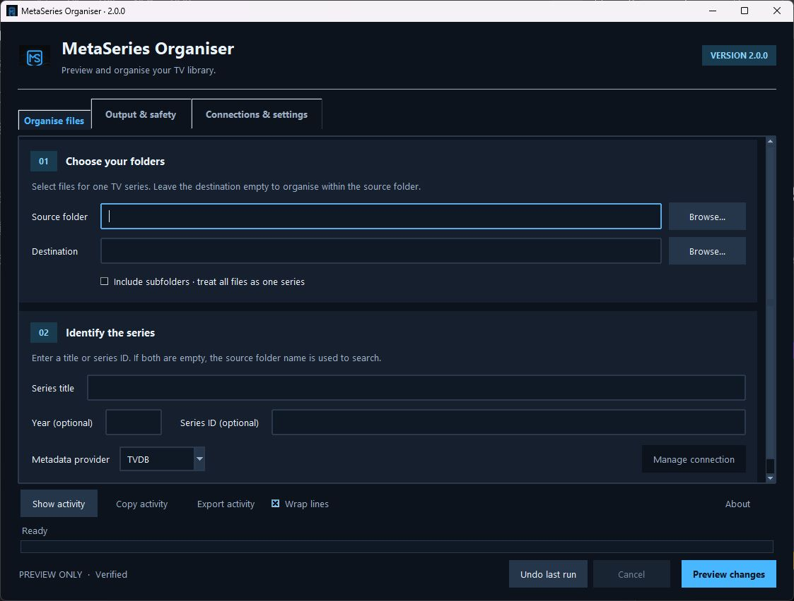

# MetaSeries Organiser

Rename and organise TV episodes with metadata from TheTVDB or TMDB. Preview the proposed filenames, resolve uncertain matches, and approve the files you want to move or copy.



**Version 2.0.0 · Python 3.11+ · Windows desktop**

## What it does

- Finds a series by name or provider ID, with a preferred metadata language.
- Supports aired, DVD and absolute numbering. DVD order requires TheTVDB.
- Recognises episode numbers, dates, multi-episode files, specials and common extra-file suffixes.
- Lets you inspect source and destination filenames before approving a run.
- Moves or copies files with a choice of verification methods; BLAKE3 is the default.
- Optionally writes episode NFO files and scans subfolders belonging to one show.
- Records each run so Undo can restore moved files or remove unchanged copies.

## Run from source

Install [Python 3.11 or newer](https://www.python.org/downloads/windows/) with Tcl/Tk support, then open PowerShell in this folder:

```powershell
py -3 -m venv .venv
.\.venv\Scripts\python.exe -m pip install --upgrade pip
.\.venv\Scripts\python.exe -m pip install -r requirements.txt
.\.venv\Scripts\python.exe metaseries.py
```

The app opens directly to its main window. Add `--splash` to show the optional startup splash; the older `--nosplash` option still works. Windows is the primary target. The source uses Tkinter and has platform-specific state locations for macOS and Linux, but those platforms need their own installation and GUI checks.

## Organise a show

1. In **Organise files**, choose the source folder containing episodes for one show. Select **Include subfolders** when those episodes span several folders. Choose an optional destination; leaving it empty organises files within the source location.
2. Select TVDB or TMDB and enter the series name, or its numeric provider ID.
3. Open **Connections & settings** to enter that provider's API key. A TVDB PIN is only needed if one was issued with your key. Use **Test selected provider** to check the connection.
4. In **Output & safety**, choose Move or Copy, the language, episode order and verification mode. Keep **Preview only** enabled for the first pass.
5. Choose **Preview changes**, inspect the proposed names and resolve uncertain episodes. Accepting the preview records the proposed changes in the activity log and leaves your files untouched.
6. Once the plan looks right, turn off **Preview only** in **Output & safety**. Choose **Review & move** or **Review & copy**, then approve the files you want to process.

**Copy** keeps the original files. **Move** removes each original after its transfer passes the selected checks. Existing destination files are never overwritten; conflicting names are adjusted during planning and checked again during execution.

### Verification

| Mode | Behaviour |
| --- | --- |
| Verified | Uses BLAKE3. Copies are hashed as they are written and the destination is read back for comparison. Same-volume moves also check file identity. |
| Quick | Uses file identity for same-volume moves. Copies use sampled content checks by default, or size checks when sampling is disabled. |
| Custom | Choose XXH3-128, BLAKE3, SHA-256, a sampled fingerprint, size and identity checks, or no content verification. |

Sampled checks can miss changes outside the sampled regions. Selecting no content verification still retains the application's ownership and source-change guards.

### Undo and cancellation

**Undo last run** reads the latest outstanding recovery record. It checks recorded ownership and content information before restoring or removing a file. If a file has changed or an original location is occupied, it leaves that file in place and reports the issue in the log.

Cancellation stops work at a safe checkpoint. Completed operations stay recorded for Undo. Keep the recovery records until you no longer need to undo the run.

## Settings and credentials

Normal mode saves settings, logs and recovery records under:

```text
%LOCALAPPDATA%\MetaSeries-Organiser\
```

Credentials use the operating system's keyring. If secure storage is unavailable, the app keeps entered credentials for the current session and tells you they were not saved.

Portable mode stores application state in `data` beside the script or executable and encrypts saved credentials using AES-GCM with a passphrase. Enable it in the app, set `MSO_PORTABLE=1`, or place an empty `portable.flag` beside the script or executable. The application folder must be writable. Keep the vault passphrase somewhere you can retrieve it; the app cannot recover it for you.

An optional [example configuration](config/settings.example.json) documents the settings without including personal paths or credentials. The app creates its working configuration automatically.

TheTVDB and TMDB credentials are separate. Obtain them through the provider you intend to use: [TheTVDB](https://thetvdb.com/) or [TMDB](https://www.themoviedb.org/). Provider access and account requirements are managed by those services.

Keyboard shortcuts: **Ctrl+Enter** starts a preview or review, **Ctrl+,** opens connection settings, and **F1** opens About.

## Build a Windows application

The build produces a folder containing the executable and its required files. Python is not needed on the computer running that folder.

```powershell
.\.venv\Scripts\python.exe -m pip install -r requirements-dev.txt
.\scripts\build-windows.ps1
```

The result is `dist\2.0.0\MetaSeries-Organiser\MetaSeries-Organiser.exe`. Distribute the whole `MetaSeries-Organiser` folder, including `_internal`, or the ZIP created alongside it. Keep the internal files beside the executable.

The script runs the tests before packaging. For a different Python environment, pass `-Python "C:\path\to\python.exe"`. Builds must run on Windows. See [the release guide](docs/releasing.md) for the checks to make before publishing a version.

## Development

```powershell
.\.venv\Scripts\python.exe -m pip install -r requirements-dev.txt
.\.venv\Scripts\python.exe -m pytest -q
```

Automated checks use temporary files and mocked provider responses. They do not prove that a live provider account works; test your own account using **Test selected provider** in the app. See [CONTRIBUTING.md](CONTRIBUTING.md) for the project layout and contribution guidance.

See [the 2.0.0 validation record](docs/validation.md) for the completed checks and remaining platform validation.

For isolated development or GUI checks, set `MSO_STATE_DIR` to a disposable directory before starting the app. It redirects settings, logs, recovery records and portable vault files, including when portable mode is enabled. It does not redirect the operating system's credential manager; use disposable credentials or a portable vault for checks that save keys.

## Licence and acknowledgements

The application code is available under the [MIT licence](LICENSE). Provider logos and other third-party material retain their respective owners' rights; see [ATTRIBUTION.md](ATTRIBUTION.md).

This product uses the TMDB API but is not endorsed or certified by TMDB. Metadata is also provided by TheTVDB. Please consider contributing missing information or subscribing.

## Development history

See [the development history](HISTORY.md) for earlier source snapshots and how they relate to the current release.
